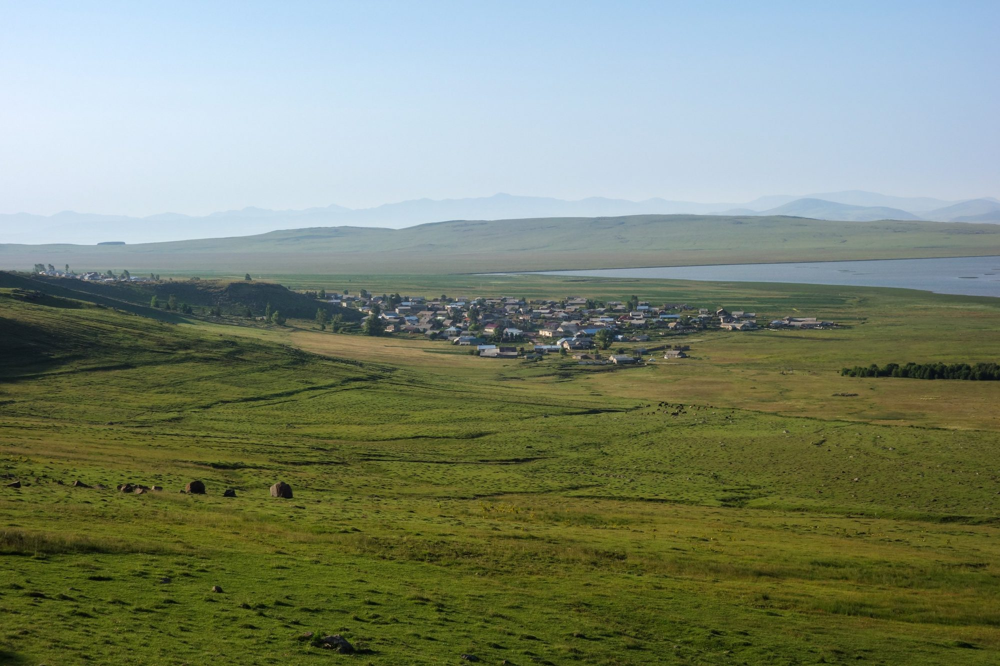

# The House Bdoyan · Բդոյանների տոհմ · Род Бдоянов

**A history of the Bdoyan family, from Dinarigom on the Karin plain to Pokr Khanchali on Lake Khanchali, 1829–2026.**

🌐 **Read it online: [harutbdo.github.io/house-bdoyan](https://harutbdo.github.io/house-bdoyan/)**



> 🇦🇲 Բդոյանների գերդաստանի պատմությունը՝ Կարնո դաշտի Դինարիգոմ գյուղից մինչև Խանչալի լճի ափի Փոքր Խանչալի։
>
> 🇷🇺 История рода Бдоянов — от села Динаригом на Карнской равнине до Покр Ханчали на озере Ханчали.

## About

This is the story of one household that became a family name. It begins with a man called **Bdo (Bedros)** on the high plain of Karin (today's Erzurum), follows his descendants across a closing frontier in 1829–1830 to Lake Khanchali in Javakhk, and gathers every Bdoyan the records name, from his time to ours.

The book is written in **Armenian, English and Russian**. The website opens in Armenian; use the ՀԱՅ · EN · РУС buttons at the top to switch.

### Contents

| | Chapter |
|---|---|
| I | Bdo of the Karin Plain |
| II | The Great Exodus, 1829–1830 |
| III | A New Home on Lake Khanchali |
| IV | Vard Bdoyan, the Family's Scholar |
| V | One Ancestor, One Family |
| VI | The Bdoyans We Know |
| VII | Where the Bdoyans Live Today |
| ✦ | Afterword: How This History Could Be Written |

Every statement in the book is marked by how certain it is: ● confirmed by a record, ◐ probable, ○ family tradition or estimate. Sources are given in the chapter notes.

## Download the books

| | English | Հայերեն | Русский |
|---|---|---|---|
| **The book** | [PDF, 11 MB](files/book_en.pdf) | [PDF, 10 MB](files/book_hy.pdf) | [PDF, 12 MB](files/book_ru.pdf) |
| **Research handbook** | [PDF, 3 MB](files/handbook_en.pdf) | [PDF, 3 MB](files/handbook_hy.pdf) | [PDF, 3 MB](files/handbook_ru.pdf) |

The research handbook lists the archive references (National Archives of Armenia, FamilySearch microfilms 1915055 and 1915180) and includes worksheets for collecting family information.

## Add your branch

The history is not finished, and every Bdoyan can help: names, dates, photographs, stories of the elders, or an offer to search an archive.

- **On the website:** fill in the form under *Contribute* and send the prepared message by email, WhatsApp or Telegram.
- **On GitHub:** [open an issue](../../issues/new/choose) to add information or correct a mistake.

See [CONTRIBUTING.md](CONTRIBUTING.md) for what is most useful and how information about living people is handled.

## Repository structure

```
index.html            the whole website (all three languages)
img/                  photographs, maps and charts
files/                the books and handbooks as PDF
404.html              page shown for broken links
.github/workflows/    deploys the site to GitHub Pages on every push to main
```

The site is a single static page with no build step. To change it, edit `index.html` and push to `main`; GitHub Pages republishes it within a minute or two. To preview it on your own computer, open `index.html` in a browser, or run `python3 -m http.server` in this folder and visit http://localhost:8000.

## Credits

Compiled by **Harutyun Bdoyan**. Researched and written with the help of Claude, an AI model by Anthropic.

- Photographs from Wikimedia Commons: Yasuhiro Kojima, Paata Vardanashvili and Dor Shabashewitz ([CC BY-SA 4.0](https://creativecommons.org/licenses/by-sa/4.0/)), Aleksey Muhranoff ([CC BY-SA 3.0](https://creativecommons.org/licenses/by-sa/3.0/)), Brian Dell (public domain)
- Maps made with [Natural Earth](https://www.naturalearthdata.com/) data (public domain)
- Key source: Vard Harutyuni Bdoyan (1910–1986), ethnographic work on Javakhk, published 2014

## License

© 2026 Harutyun Bdoyan. The text and books are for personal and family use; see [LICENSE](LICENSE) for details and for the licenses of the photographs and maps.
